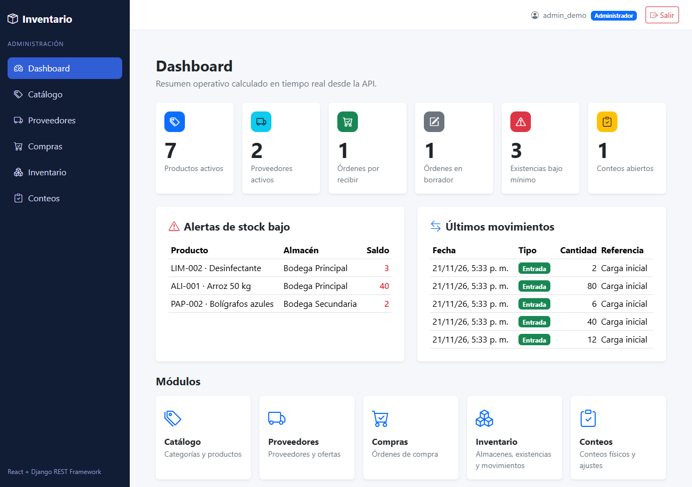

# Sistema de Gestión de Inventario y Abastecimiento

Aplicación de dos capas para la gestión centralizada de inventario, catálogo de productos, proveedores, órdenes de compra y conteos físicos de almacén:

- **Backend** (Proyecto 1): API REST con **Python**, **Django** y **Django REST Framework (DRF)** — en la raíz de este repositorio (`apps/`, `config/`, `manage.py`).
- **Frontend** (Proyecto 2): SPA con **React + Vite + Bootstrap 5** que consume esa API — carpeta [`frontend/`](frontend/).



## Inicio rápido

Requisitos: **Python 3.10+**, **Node.js 20+** y **MySQL** (con una base de datos vacía llamada `inventario`). Abra **dos terminales** en la raíz del proyecto.

**Terminal 1 — Backend** (Windows; en Linux/macOS active con `source .venv/bin/activate`):
```bash
python -m venv .venv
.venv\Scripts\activate
pip install -r requirements.txt
cp .env.example .env
```
Edite `.env` y escriba su `DB_USER` y `DB_PASSWORD` de MySQL. Luego:
```bash
python manage.py migrate
python manage.py cargar_demo
python manage.py runserver
```

**Terminal 2 — Frontend**:
```bash
cd frontend
npm install
cp .env.example .env
npm run dev
```

Abra **http://localhost:5173** e ingrese con un usuario de prueba (ficticios, creados por `cargar_demo`):

| Usuario | Contraseña | Perfil | Puede |
| :--- | :--- | :--- | :--- |
| `admin_demo` | `Admin12345!` | Administrador | Todo, incluido eliminar |
| `operador_demo` | `Operador12345!` | Operador | Consultar, crear, editar y ejecutar acciones; no eliminar |
| `consulta_demo` | `Consulta12345!` | Consulta | Solo consultar |

> `cargar_demo` es idempotente: crea los roles, los tres usuarios y datos de ejemplo (categorías, productos, proveedores, ofertas, almacenes, existencias, órdenes y un conteo abierto). El `.env.example` viene configurado para MySQL. Si no tiene MySQL, cambie en su `.env` la línea `DB_ENGINE=mysql` por `DB_ENGINE=sqlite` y el backend usará SQLite sin más configuración. En PowerShell, copie el `.env` con `Copy-Item .env.example .env`.

---

## Tabla de Contenidos

- [Inicio rápido](#inicio-rápido)
- [Frontend React](#frontend-react)
- [Visión General](#visión-general)
- [Arquitectura de Módulos](#arquitectura-de-módulos)
- [Requisitos Previos](#requisitos-previos)
- [Instalación y Configuración](#instalación-y-configuración)
- [Mapeo de Roles y Permisos](#mapeo-de-roles-y-permisos)
- [Endpoints Principales](#endpoints-principales)
- [Pruebas Automatizadas](#pruebas-automatizadas)
- [Colección de Postman](#colección-de-postman)
- [Limitaciones Conocidas y Notas Técnicas](#limitaciones-conocidas-y-notas-técnicas)

---

## Frontend React

SPA en `frontend/` que reutiliza el backend de este repositorio. Su estructura, estilo visual (barra lateral oscura, tarjetas con sombra, tablas Bootstrap) y patrones (`AuthContext`, rutas protegidas, cliente Axios centralizado, servicios por recurso) siguen el frontend de referencia `arena-game-frontend`.

### Tecnologías
React 19 (componentes funcionales y hooks), Vite, React Router, Axios, Bootstrap 5 y Bootstrap Icons.

### Configuración
- `frontend/.env.example` define `VITE_API_URL` (por defecto `http://127.0.0.1:8000/api/v1`). Cópielo a `frontend/.env`; no contiene secretos.
- **CORS**: el backend autoriza los orígenes de `CORS_ALLOWED_ORIGINS` (por defecto `http://localhost:5173,http://127.0.0.1:5173`; se puede cambiar agregando esa variable al `.env`). Si cambia el puerto o dominio del frontend, actualice esa variable y reinicie Django.
- Otros comandos: `npm run build` (compilación de producción) y `npm run lint`.

### Pantallas y funcionalidades

| Módulo | Contenido | CRUD |
| :--- | :--- | :--- |
| Dashboard | 6 indicadores en tiempo real, alertas de stock bajo, últimos movimientos y accesos | — |
| Catálogo | Productos y categorías | Completo |
| Proveedores | Proveedores y ofertas proveedor-producto (N:M con costo) | Completo |
| Compras | Órdenes, detalle con líneas, **enviar** y **recibir** (actualiza inventario) | Completo |
| Inventario | Existencias (con filtro «bajo mínimo»), historial de movimientos, **registrar salida**, almacenes | Almacenes completo; existencias y movimientos son solo lectura por diseño |
| Conteos | Conteos, detalle con líneas, **cerrar** (genera ajustes) | Completo |

- **Búsqueda, filtros combinables, ordenamiento y paginación** se envían al backend (`search`, filtros, `ordering`, `page`); no hay filtrado local.
- **Formularios controlados** con selectores de relaciones consultados a la API, validación previa y valores precargados al editar.
- **Errores**: mensajes comprensibles para 400 (campo por campo), 401 (sesión expirada → login), 403, 404, 409 y fallos de red; confirmación antes de eliminar y avisos de éxito.
- **Permisos**: el perfil se consulta a `GET /api/v1/auth/me/` y se ocultan las acciones no permitidas, pero la autorización real sigue en Django (la API devuelve 403 aunque se manipule la interfaz).
- **Diseño adaptable**: barra lateral en escritorio, menú desplazable en móvil, tablas con scroll interno.

### Autenticación y cierre de sesión
Login con `POST /api/v1/auth/token/`; el token se guarda en `sessionStorage` y se adjunta como `Authorization: Token …`. Al cerrar sesión se llama a `POST /api/v1/auth/logout/`, que **revoca (elimina) el token en el servidor**, y se limpia la sesión local. Si el servidor responde 401 en cualquier momento, el frontend cierra la sesión y vuelve al login.

### Ampliaciones realizadas al backend
CORS (`django-cors-headers`), `GET auth/me/`, `POST auth/logout/`, respuesta **409** al borrar registros con relaciones protegidas y bloqueo del borrado de líneas de órdenes y conteos cerrados. El detalle y la justificación están en [`docs/frontend-integracion.md`](docs/frontend-integracion.md), que además incluye la **matriz de pantallas y endpoints**, la **matriz de perfiles/permisos** y **19 escenarios manuales** con capturas (`docs/capturas/`).

### Estructura de `frontend/src`
```
api/client.js    URL base, interceptores (token y 401) y traducción de errores HTTP
auth/            AuthContext (login, logout, perfil) y ProtectedRoute
services/        Un servicio por recurso (crud.js genérico + acciones de negocio)
hooks/           useList (paginación, filtros, orden) y useOpciones (selectores)
components/      Layout, PanelRecurso, FormEntidad, Paginacion, Alerta, Modal, Tabs
pages/           Una página por módulo; paneles por entidad en subcarpetas
```

### Verificación realizada
- `python manage.py test` (backend, incluidas las pruebas nuevas), `npm run build` y `npm run lint` sin errores.
- Recorrido de extremo a extremo con navegador real (Chrome headless) contra la API real: login/logout, rutas protegidas, CRUD, búsqueda y filtros, reglas de negocio, flujos enviar/recibir y cerrar conteo, 401/403/409, los tres perfiles y vista móvil.

---

## Visión General

El sistema atiende la necesidad operativa de una pequeña o mediana organización para llevar el control de stock en tiempo real. Permite:
- Mantener un catálogo de productos estructurado por categorías.
- Registrar proveedores y gestionar catálogos de ofertas/costos de productos.
- Crear, enviar y recibir órdenes de compra que alimentan automáticamente el inventario.
- Controlar existencias físicas por almacén y registrar movimientos de auditoría (entradas/salidas).
- Efectuar conteos físicos periódicos para conciliar las existencias del sistema contra la realidad en almacén.

---

## Arquitectura de Módulos

El proyecto está segmentado en **5 módulos de negocio** y **1 de soporte**:

1. **`apps.catalogo`**: Control de categorías, productos, SKU, unidades de medida y stock mínimo.
2. **`apps.proveedores`**: Gestión de proveedores y ofertas comerciales (relación N:M entre producto y proveedor con precios de referencia).
3. **`apps.compras`**: Órdenes de compra y sus líneas de detalle. Gestiona el flujo `borrador` $\rightarrow$ `enviada` $\rightarrow$ `recibida`.
4. **`apps.inventario`**: Administración de almacenes, saldos (`Existencia`) y registro histórico de auditoría (`Movimiento`).
5. **`apps.conteos`**: Auditoría y toma de inventario físico por almacén; concilia diferencias y ajusta automáticamente las existencias.
6. **`apps.common`**: Módulo transversal de soporte (no expone modelos); incluye utilidades, clases de permisos y el comando de inicialización de roles.

---

## Requisitos Previos

- **Python 3.10+**
- **Virtualenv / venv**
- Base de datos relacional: **SQLite** (por defecto para desarrollo local) o **PostgreSQL** / **MySQL**.
- Git

---

## Instalación y Configuración

Sigue estos pasos para desplegar el entorno de desarrollo desde una instalación limpia:

### 1. Clonar el repositorio
```bash
git clone https://github.com/fiorelladuque9-maker/proyectoInventario.git
cd proyectoInventario
```
> Todos los comandos de esta sección se ejecutan en la raíz del repositorio.

### 2. Crear y activar el entorno virtual
En Linux/macOS:
```bash
python3 -m venv .venv
source .venv/bin/activate
```

En Windows:
```cmd
python -m venv .venv
.venv\Scripts\activate
```

### 3. Instalar dependencias
```bash
pip install --upgrade pip
pip install -r requirements.txt
```

### 4. Configurar variables de entorno
Copia la plantilla de variables de entorno y ajusta los valores según tu configuración local:
```bash
cp .env.example .env
```

> **Nota:** La plantilla `.env.example` está configurada para MySQL (cree antes una base de datos vacía llamada `inventario`). Si no se define `DB_ENGINE`, el proyecto utiliza SQLite (`db.sqlite3`). Para PostgreSQL o MySQL, actualiza las variables `DB_ENGINE`, `DB_NAME`, `DB_USER`, `DB_PASSWORD`, `DB_HOST` y `DB_PORT`.

### 5. Ejecutar migraciones de base de datos
```bash
python manage.py migrate
```

### 6. Inicializar Roles y Perfiles
Ejecuta el comando personalizado e idempotente para crear los grupos de seguridad obligatorios (`Administrador`, `Operador`, `Consulta`):
```bash
python manage.py crear_roles
```

### 7. (Opcional) Cargar usuarios y datos de ejemplo
```bash
python manage.py cargar_demo
```

### 8. Crear Superusuario (Administrador del Sistema)
```bash
python manage.py createsuperuser
```

### 9. Iniciar el servidor de desarrollo
```bash
python manage.py runserver
```
La API estará disponible en: `http://127.0.0.1:8000/api/v1/`

---

## Mapeo de Roles y Permisos

El sistema implementa seguridad basada en roles mediante `TokenAuthentication` y la clase personalizada `InventarioRolePermission`.

### Perfiles de Usuario

- **`Administrador`**: Acceso total al sistema (Lectura, Creación, Actualización y Eliminación / `DELETE`).
- **`Operador`**: Acceso operativo (Lectura, Creación, Edición y ejecución de Acciones de Negocio). No puede eliminar registros.
- **`Consulta`**: Acceso exclusivo de solo lectura (`GET`, `HEAD`, `OPTIONS`).

### Matriz de Permisos General

| Método HTTP | Administrador | Operador | Consulta | Sin Grupo / Sin Token |
| :--- | :---: | :---: | :---: | :---: |
| **GET / HEAD / OPTIONS** | Permitido | Permitido | Permitido | 403 / 401 |
| **POST / PUT / PATCH** | Permitido | Permitido | 403 | 403 / 401 |
| **DELETE** | Permitido | 403 | 403 | 403 / 401 |
| **Acciones Especiales (Ej. Recepción, Salida, Cierre)** | Permitido | Permitido | 403 | 403 / 401 |

---

## Endpoints Principales

Todos los endpoints requieren la cabecera `Authorization: Token <token>` (excepto salud y obtención de token).

### Autenticación y Salud
- `POST /api/v1/auth/token/`: Obtención de token con `username` y `password`.
- `GET /api/v1/auth/me/`: Perfil del usuario autenticado (`rol`, `puede_escribir`, `puede_eliminar`).
- `POST /api/v1/auth/logout/`: Revoca (elimina) el token del usuario autenticado.
- `GET /api/v1/health/`: Estado de salud del servicio (público).

### Módulos CRUD
- **Categorías**: `/api/v1/categorias/`
- **Productos**: `/api/v1/productos/` (incluye ordenamiento, filtros por categoría/activo y cálculo de `stock_total`).
- **Proveedores**: `/api/v1/proveedores/`
- **Ofertas Proveedor-Producto**: `/api/v1/productos-proveedor/`
- **Órdenes de Compra**: `/api/v1/ordenes-compra/`
- **Líneas de Compra**: `/api/v1/lineas-compra/`
- **Almacenes**: `/api/v1/almacenes/`
- **Existencias**: `/api/v1/existencias/` (Solo Lectura)
- **Movimientos**: `/api/v1/movimientos/` (Solo Lectura)
- **Conteos**: `/api/v1/conteos/`
- **Líneas de Conteo**: `/api/v1/lineas-conteo/`

### Acciones de Negocio Destacadas
- `POST /api/v1/ordenes-compra/{id}/enviar/`: Pasa una orden de borrador a enviada.
- `POST /api/v1/ordenes-compra/{id}/recibir/`: Recibe la orden e incrementa el inventario en el almacén destino.
- `GET /api/v1/existencias/bajo-minimo/`: Muestra saldos por almacén que están por debajo del `stock_minimo` del producto.
- `POST /api/v1/movimientos/registrar-salida/`: Registra una salida manual validando que exista saldo suficiente.
- `POST /api/v1/conteos/{id}/cerrar/`: Procesa las diferencias contadas y genera automáticamente las entradas/salidas de ajuste.

---

## Reglas de negocio y validaciones

Las validaciones de entrada devuelven errores JSON con código `400`. Las reglas principales son:

1. No se puede crear una orden para un proveedor inactivo.
2. La cantidad de una línea de compra debe ser mayor que cero.
3. El costo unitario de una línea y el costo referencial de una oferta no pueden ser negativos.
4. La cantidad recibida no puede superar la cantidad solicitada.
5. El producto de una línea de compra debe estar asociado al proveedor de la orden.
6. Solo se puede enviar una orden en borrador que tenga al menos una línea.
7. Solo se puede recibir una orden enviada y en un almacén activo; la recepción es completa y no se repite.
8. Las órdenes recibidas o canceladas y sus líneas no se pueden reabrir ni modificar.
9. Una salida requiere un producto y un almacén activos, una cantidad positiva y saldo suficiente.
10. Un conteo solo se puede cerrar una vez y cuando todas sus líneas tengan cantidad contada; sus líneas quedan bloqueadas al cerrarlo.
11. La cantidad contada no puede ser negativa y el producto de una línea de conteo no se puede cambiar después de crearla.

Estas reglas se prueban principalmente en `apps/*/tests/`.

Las existencias y los movimientos son de solo lectura en el CRUD general para conservar un historial confiable. Se modifican mediante las acciones controladas de recepción de compras, registro de salidas y cierre de conteos.

## Pruebas Automatizadas

Para ejecutar el paquete completo de pruebas unitarias e integración:

```bash
python manage.py test
```

### Cobertura de Pruebas
La suite incluye pruebas sobre:
- Autenticación por token y comprobación de permisos (HTTP 401 y 403) para los tres roles.
- Endpoints añadidos para el frontend: perfil (`auth/me`), revocación de token, CORS, 409 en borrados protegidos y bloqueo del borrado de líneas cerradas.
- Validación de reglas de negocio en compras (envío de órdenes vacías, recepción duplicada).
- Integridad en movimientos de inventario y rechazo de salidas sin saldo suficiente.
- Captura de fotografía de saldo al crear líneas de conteo y conciliación al cerrar.
- Filtros, búsqueda y paginación en listados.

---

## Colección de Postman

La colección y el entorno para pruebas de integración están en `postman/`:

- Colección: `postman/inventario.postman_collection.json`
- Entorno: `postman/inventario-local.postman_environment.json`

Importa ambos archivos en Postman y selecciona **Inventario - Local**. La variable `base_url` apunta a `http://127.0.0.1:8000`. La colección documenta peticiones para los endpoints `/api/v1/` de este README.

## Limitaciones Conocidas y Notas Técnicas

1. **Recepción de Órdenes:** Las órdenes de compra se reciben únicamente de forma completa (`cantidad_recibida = cantidad`). La recepción parcial no está habilitada.
2. **Edición de Conteos CERRADOS:** Una vez que un conteo de inventario se marca como `cerrado`, sus líneas de detalle quedan bloqueadas contra cualquier edición posterior.
3. **Índice Raíz de Routers (`/api/v1/`):** Al usar múltiples `DefaultRouter` bajo el mismo prefijo raíz, la vista navegable predeterminada de DRF puede ocultar algunos índices del router. Los endpoints directos operan de manera totalmente independiente y normal.
4. **Instalación de MySQL:** El archivo `settings.py` incluye soporte para adaptadores de MySQL. En entornos donde no se requiera dicho motor, asegúrese de tener configuradas correctamente las dependencias del sistema operativo o utilizar el motor por defecto SQLite/PostgreSQL.