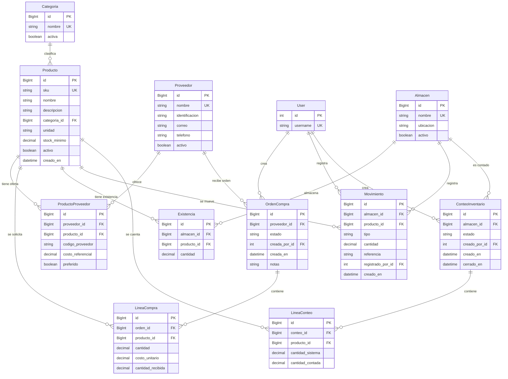

# Modelo de datos

## 1. Resumen del modelo

El modelo cubre el catálogo de productos, el abastecimiento mediante proveedores y órdenes de compra, el inventario por almacén y los conteos físicos. Hay **11 entidades de negocio** definidas en las cinco aplicaciones revisadas, más la entidad externa `User` de Django referenciada para auditoría. En términos funcionales, los modelos permiten recorrer proveedor → orden de compra y líneas → existencias y movimientos en almacén → conteo y eventual ajuste; sin embargo, no hay una relación directa en la base de datos entre una recepción de compra, un movimiento y una línea de conteo. Los modelos y las migraciones iniciales coinciden en sus campos, relaciones y restricciones (`apps/catalogo/models.py`, `apps/catalogo/migrations/0001_initial.py`, `apps/proveedores/models.py`, `apps/proveedores/migrations/0001_initial.py`, `apps/compras/models.py`, `apps/compras/migrations/0001_initial.py`, `apps/inventario/models.py`, `apps/inventario/migrations/0001_initial.py`, `apps/conteos/models.py`, `apps/conteos/migrations/0001_initial.py`).

## 2. Diagrama entidad-relación (Mermaid)

<!-- mermaid-checked: every attribute is `<type> <name> [<key>] ["<description>"]` with at most one of PK/FK/UK, no \n in descriptions, no {} in descriptions, every relationship label is double-quoted -->

`Proveedor` y `Producto` mantienen una relación N:M mediante la entidad intermedia explícita `ProductoProveedor`. Los tipos `BigInt` representan las claves del proyecto, generadas con `BigAutoField`; las claves de usuario referencian el `User` estándar de Django. El bloque muestra de `User` únicamente su clave y el campo de identidad, no pretende enumerar el esquema completo de autenticación de Django. Fuentes de las entidades de negocio: los cinco `models.py` y las migraciones iniciales indicadas en la sección 1. `AUTH_USER_MODEL` no se redefine en `config/settings.py`; las migraciones de `compras`, `inventario` y `conteos` usan `settings.AUTH_USER_MODEL`.

## 3. Diccionario de datos

Los campos `id` son claves primarias automáticas (`BigAutoField`) en las entidades de negocio. Salvo indicación explícita, los campos tienen `null=False`, `blank=False`, no tienen valor `default` y no son únicos. Los campos de fecha de creación marcados `auto_now_add` se asignan al crear el registro. Las anotaciones de opciones reflejan las definiciones en `models.py`; las FK indican también su política `on_delete`.

### Categoria — `apps/catalogo/models.py`

| Campo | Tipo | Restricciones (null, blank, default, unique, choices) | Observaciones |
|---|---|---|---|
| id | BigAutoField | PK; auto_created | Identificador automático. |
| nombre | CharField(100) | null=False; blank=False; unique=True | Nombre de categoría. |
| activa | BooleanField | null=False; blank=False; default=True | Estado de la categoría. |

### Producto — `apps/catalogo/models.py`

| Campo | Tipo | Restricciones (null, blank, default, unique, choices) | Observaciones |
|---|---|---|---|
| id | BigAutoField | PK; auto_created | Identificador automático. |
| sku | CharField(40) | null=False; blank=False; unique=True | Código único de producto. |
| nombre | CharField(160) | null=False; blank=False | Nombre de producto. |
| descripcion | TextField | null=False; blank=True | Texto opcional; `blank` no implica `null`. |
| categoria | ForeignKey a Categoria | null=False; blank=False; on_delete=PROTECT | Columna de base de datos `categoria_id`; `related_name="productos"`. |
| unidad | CharField(10) | null=False; blank=False; default="unidad"; choices: `unidad`, `kg`, `litro`, `caja` | Etiquetas: Unidad, Kilogramo, Litro y Caja. |
| stock_minimo | DecimalField(12,3) | null=False; blank=False; default=0 | También tiene un `CheckConstraint` no negativo. |
| activo | BooleanField | null=False; blank=False; default=True | Estado del producto. |
| creado_en | DateTimeField | null=False; blank=False; auto_now_add=True | Fecha/hora de creación. |

### Proveedor — `apps/proveedores/models.py`

| Campo | Tipo | Restricciones (null, blank, default, unique, choices) | Observaciones |
|---|---|---|---|
| id | BigAutoField | PK; auto_created | Identificador automático. |
| nombre | CharField(160) | null=False; blank=False; unique=True | Nombre único del proveedor. |
| identificacion | CharField(30) | null=False; blank=True | No se declara unicidad. |
| correo | EmailField(254) | null=False; blank=True | Correo opcional. |
| telefono | CharField(30) | null=False; blank=True | Teléfono opcional. |
| activo | BooleanField | null=False; blank=False; default=True | Estado del proveedor. |
| productos | ManyToManyField a Producto, through=ProductoProveedor | null/blank/default no aplican; related_name=`proveedores` | Relación N:M explícita; restricciones propias en las FK de la tabla intermedia. |

### ProductoProveedor — `apps/proveedores/models.py`

| Campo | Tipo | Restricciones (null, blank, default, unique, choices) | Observaciones |
|---|---|---|---|
| id | BigAutoField | PK; auto_created | Identificador automático. |
| proveedor | ForeignKey a Proveedor | null=False; blank=False; on_delete=CASCADE | Columna `proveedor_id`; `related_name="catalogo"`. |
| producto | ForeignKey a Producto | null=False; blank=False; on_delete=PROTECT | Columna `producto_id`; `related_name="ofertas_proveedor"`. |
| codigo_proveedor | CharField(60) | null=False; blank=True | Código opcional asignado por el proveedor. |
| costo_referencial | DecimalField(12,2) | null=False; blank=False | Tiene un `CheckConstraint` que exige valor no negativo. |
| preferido | BooleanField | null=False; blank=False; default=False | No hay unicidad condicional para un único proveedor preferido por producto. |

### OrdenCompra — `apps/compras/models.py`

| Campo | Tipo | Restricciones (null, blank, default, unique, choices) | Observaciones |
|---|---|---|---|
| id | BigAutoField | PK; auto_created | Identificador automático. |
| proveedor | ForeignKey a Proveedor | null=False; blank=False; on_delete=PROTECT | Columna `proveedor_id`; `related_name="ordenes"`. |
| estado | CharField(12) | null=False; blank=False; default="borrador"; choices: `borrador`, `enviada`, `recibida`, `cancelada` | Etiquetas declaradas en `OrdenCompra.Estado`. |
| creada_por | ForeignKey a `settings.AUTH_USER_MODEL` | null=False; blank=False; on_delete=PROTECT | Columna `creada_por_id`; `related_name="ordenes_compra"`. |
| creada_en | DateTimeField | null=False; blank=False; auto_now_add=True | Fecha/hora de creación. |
| notas | TextField | null=False; blank=True | Notas opcionales. |

### LineaCompra — `apps/compras/models.py`

| Campo | Tipo | Restricciones (null, blank, default, unique, choices) | Observaciones |
|---|---|---|---|
| id | BigAutoField | PK; auto_created | Identificador automático. |
| orden | ForeignKey a OrdenCompra | null=False; blank=False; on_delete=CASCADE | Columna `orden_id`; `related_name="lineas"`. |
| producto | ForeignKey a Producto | null=False; blank=False; on_delete=PROTECT | Columna `producto_id`; `related_name="lineas_compra"`. |
| cantidad | DecimalField(12,3) | null=False; blank=False | Check de valor estrictamente positivo. |
| costo_unitario | DecimalField(12,2) | null=False; blank=False | Check de valor no negativo. |
| cantidad_recibida | DecimalField(12,3) | null=False; blank=False; default=0 | Check de valor no negativo; límite respecto a `cantidad` validado en serializer, no en BD. |

### Almacen — `apps/inventario/models.py`

| Campo | Tipo | Restricciones (null, blank, default, unique, choices) | Observaciones |
|---|---|---|---|
| id | BigAutoField | PK; auto_created | Identificador automático. |
| nombre | CharField(120) | null=False; blank=False; unique=True | Nombre único del almacén. |
| ubicacion | CharField(200) | null=False; blank=True | Ubicación opcional. |
| activo | BooleanField | null=False; blank=False; default=True | Estado del almacén. |

### Existencia — `apps/inventario/models.py`

| Campo | Tipo | Restricciones (null, blank, default, unique, choices) | Observaciones |
|---|---|---|---|
| id | BigAutoField | PK; auto_created | Identificador automático. |
| almacen | ForeignKey a Almacen | null=False; blank=False; on_delete=PROTECT | Columna `almacen_id`; `related_name="existencias"`. |
| producto | ForeignKey a Producto | null=False; blank=False; on_delete=PROTECT | Columna `producto_id`; `related_name="existencias"`. |
| cantidad | DecimalField(12,3) | null=False; blank=False; default=0 | Check de valor no negativo. |

### Movimiento — `apps/inventario/models.py`

| Campo | Tipo | Restricciones (null, blank, default, unique, choices) | Observaciones |
|---|---|---|---|
| id | BigAutoField | PK; auto_created | Identificador automático. |
| almacen | ForeignKey a Almacen | null=False; blank=False; on_delete=PROTECT | Columna `almacen_id`; `related_name="movimientos"`. |
| producto | ForeignKey a Producto | null=False; blank=False; on_delete=PROTECT | Columna `producto_id`; `related_name="movimientos"`. |
| tipo | CharField(10) | null=False; blank=False; choices: `entrada`, `salida`, `ajuste` | No tiene valor predeterminado. |
| cantidad | DecimalField(12,3) | null=False; blank=False | Check de valor estrictamente positivo. |
| referencia | CharField(120) | null=False; blank=True | Referencia opcional sin FK declarada. |
| registrado_por | ForeignKey a `settings.AUTH_USER_MODEL` | null=False; blank=False; on_delete=PROTECT | Columna `registrado_por_id`; `related_name="movimientos_inventario"`. |
| creado_en | DateTimeField | null=False; blank=False; auto_now_add=True | Fecha/hora de creación. |

### ConteoInventario — `apps/conteos/models.py`

| Campo | Tipo | Restricciones (null, blank, default, unique, choices) | Observaciones |
|---|---|---|---|
| id | BigAutoField | PK; auto_created | Identificador automático. |
| almacen | ForeignKey a Almacen | null=False; blank=False; on_delete=PROTECT | Columna `almacen_id`; `related_name="conteos"`. |
| estado | CharField(10) | null=False; blank=False; default="abierto"; choices: `abierto`, `cerrado` | Etiquetas declaradas en `ConteoInventario.Estado`. |
| creado_por | ForeignKey a `settings.AUTH_USER_MODEL` | null=False; blank=False; on_delete=PROTECT | Columna `creado_por_id`; `related_name="conteos_inventario"`. |
| creado_en | DateTimeField | null=False; blank=False; auto_now_add=True | Fecha/hora de creación. |
| cerrado_en | DateTimeField | null=True; blank=True | Sin valor predeterminado explícito. |

### LineaConteo — `apps/conteos/models.py`

| Campo | Tipo | Restricciones (null, blank, default, unique, choices) | Observaciones |
|---|---|---|---|
| id | BigAutoField | PK; auto_created | Identificador automático. |
| conteo | ForeignKey a ConteoInventario | null=False; blank=False; on_delete=CASCADE | Columna `conteo_id`; `related_name="lineas"`. |
| producto | ForeignKey a Producto | null=False; blank=False; on_delete=PROTECT | Columna `producto_id`; `related_name="lineas_conteo"`. |
| cantidad_sistema | DecimalField(12,3) | null=False; blank=False | Check de valor no negativo. |
| cantidad_contada | DecimalField(12,3) | null=True; blank=True | Si no es nula, un check exige valor no negativo. |

### User — modelo externo de Django

| Campo | Tipo | Restricciones (null, blank, default, unique, choices) | Observaciones |
|---|---|---|---|
| id | AutoField | PK | Clave primaria del `User` estándar; representada aquí por sus referencias desde el proyecto. |
| username | CharField(150) | unique=True | Campo identificador del modelo estándar de Django. |

El esquema completo de autenticación (`User`, grupos y permisos) pertenece a `django.contrib.auth`, no a los modelos de negocio del repositorio. El proyecto usa `settings.AUTH_USER_MODEL` en las FK de auditoría y no declara un modelo de usuario propio (`config/settings.py`, `apps/compras/models.py`, `apps/inventario/models.py`, `apps/conteos/models.py`).

## 4. Tabla de relaciones y políticas de borrado (RF-03)

En las filas 1:N, el origen es el modelo que declara el campo FK y el destino es el modelo referenciado. La política anotada es la de ese campo. Las justificaciones siguientes son propuestas de diseño, no afirmaciones de requisitos existentes.

| Relación (origen → destino) | Tipo | `on_delete` real | Justificación |
|---|---|---|---|
| Producto.categoria → Categoria | 1:N | PROTECT | (justificación propuesta) Protege la clasificación de productos existentes y evita borrar una categoría todavía utilizada. |
| ProductoProveedor.proveedor → Proveedor | 1:N | CASCADE | (justificación propuesta) La oferta/intersección depende del proveedor; sin él, esa fila intermedia deja de tener sentido. |
| ProductoProveedor.producto → Producto | 1:N | PROTECT | (justificación propuesta) Conserva productos referenciados por ofertas y evita eliminarlos mientras tengan relaciones de abastecimiento. |
| OrdenCompra.proveedor → Proveedor | 1:N | PROTECT | (justificación propuesta) Preserva la trazabilidad de órdenes históricas con su proveedor. |
| OrdenCompra.creada_por → User | 1:N | PROTECT | (justificación propuesta) Conserva la atribución de autoría de la orden. |
| LineaCompra.orden → OrdenCompra | 1:N | CASCADE | (justificación propuesta) Una línea de detalle no tiene sentido sin su orden padre. |
| LineaCompra.producto → Producto | 1:N | PROTECT | (justificación propuesta) Evita perder la identidad del producto referenciado por una línea de compra histórica. |
| Existencia.almacen → Almacen | 1:N | PROTECT | (justificación propuesta) Impide borrar un almacén que mantiene registros de existencia. |
| Existencia.producto → Producto | 1:N | PROTECT | (justificación propuesta) Impide borrar un producto que tiene cantidades registradas. |
| Movimiento.almacen → Almacen | 1:N | PROTECT | (justificación propuesta) Protege el historial de movimientos asociado al almacén. |
| Movimiento.producto → Producto | 1:N | PROTECT | (justificación propuesta) Protege la trazabilidad del producto en el historial de movimientos. |
| Movimiento.registrado_por → User | 1:N | PROTECT | (justificación propuesta) Conserva quién registró cada movimiento. |
| ConteoInventario.almacen → Almacen | 1:N | PROTECT | (justificación propuesta) Mantiene identificable el almacén de un conteo histórico. |
| ConteoInventario.creado_por → User | 1:N | PROTECT | (justificación propuesta) Conserva la atribución de creación del conteo. |
| LineaConteo.conteo → ConteoInventario | 1:N | CASCADE | (justificación propuesta) Las líneas son detalle del conteo y no tienen sentido sin él. |
| LineaConteo.producto → Producto | 1:N | PROTECT | (justificación propuesta) Conserva qué producto fue incluido en cada conteo. |
| Proveedor.productos ↔ Producto.proveedores | N:M | No aplica a la relación declarativa; through=`ProductoProveedor` | (justificación propuesta) La tabla intermedia permite guardar costo, código del proveedor y preferencia para cada par proveedor-producto. Sus FK usan CASCADE hacia proveedor y PROTECT hacia producto. |

Las decisiones reales `PROTECT` y `CASCADE` se encuentran en los campos FK de `apps/catalogo/models.py`, `apps/proveedores/models.py`, `apps/compras/models.py`, `apps/inventario/models.py` y `apps/conteos/models.py`; el patrón de las FK de usuario está definido contra `settings.AUTH_USER_MODEL` en `apps/compras/models.py`, `apps/inventario/models.py` y `apps/conteos/models.py`.

## 5. Restricciones únicas y de integridad

Las reglas de existencia de la columna/regla se verificaron en los modelos y se contrastaron con las migraciones `0001_initial.py` de cada app. La explicación de propósito es una propuesta de diseño.

| Nombre | Entidad | Regla | Por qué existe |
|---|---|---|---|
| `unique=True` (sin nombre de constraint declarado) | Categoria | `nombre` único | (justificación propuesta) Evita categorías duplicadas por nombre. |
| `unique=True` (sin nombre de constraint declarado) | Producto | `sku` único | (justificación propuesta) Permite identificar cada producto por un código no repetido. |
| `producto_stock_minimo_no_negativo` | Producto | `stock_minimo >= 0` | (justificación propuesta) Un umbral de reposición negativo no representa una cantidad válida. |
| `unique=True` (sin nombre de constraint declarado) | Proveedor | `nombre` único | (justificación propuesta) Evita duplicados exactos de nombre de proveedor. |
| `proveedor_producto_unico` | ProductoProveedor | Combinación `(proveedor, producto)` única | (justificación propuesta) Impide registrar varias ofertas para el mismo par proveedor-producto. |
| `oferta_costo_no_negativo` | ProductoProveedor | `costo_referencial >= 0` | (justificación propuesta) Impide costos de referencia negativos. |
| `producto_unico_por_orden` | LineaCompra | Combinación `(orden, producto)` única | (justificación propuesta) Mantiene una sola línea por producto en una orden. |
| `linea_compra_cantidad_positiva` | LineaCompra | `cantidad > 0` | (justificación propuesta) Una línea debe solicitar una cantidad positiva. |
| `linea_compra_costo_no_negativo` | LineaCompra | `costo_unitario >= 0` | (justificación propuesta) Un costo unitario no debe ser negativo. |
| `linea_compra_recibida_no_negativa` | LineaCompra | `cantidad_recibida >= 0` | (justificación propuesta) La cantidad recibida acumulada no debe ser negativa. |
| `unique=True` (sin nombre de constraint declarado) | Almacen | `nombre` único | (justificación propuesta) Evita almacenes duplicados con el mismo nombre. |
| `existencia_producto_por_almacen_unica` | Existencia | Combinación `(almacen, producto)` única | (justificación propuesta) Mantiene un registro de cantidad por producto y almacén. |
| `existencia_cantidad_no_negativa` | Existencia | `cantidad >= 0` | (justificación propuesta) La existencia no puede ser negativa según la regla expresada por el modelo. |
| `movimiento_cantidad_positiva` | Movimiento | `cantidad > 0` | (justificación propuesta) El movimiento guarda una magnitud positiva y distingue su tipo en otro campo. |
| `producto_unico_por_conteo` | LineaConteo | Combinación `(conteo, producto)` única | (justificación propuesta) Evita contar varias veces el mismo producto dentro de un conteo. |
| `conteo_sistema_no_negativo` | LineaConteo | `cantidad_sistema >= 0` | (justificación propuesta) El saldo capturado como cantidad de sistema no debe ser negativo. |
| `conteo_fisico_no_negativo` | LineaConteo | `cantidad_contada` es nula o `cantidad_contada >= 0` | (justificación propuesta) Permite conteos pendientes en nulo y evita cantidades físicas negativas. |

## 6. Cumplimiento de RF-03

- [x] **Claves primarias:** todas las entidades de negocio tienen `id` automático; los usuarios se identifican mediante la PK del `User` estándar (ver los `models.py` citados en las secciones 1 y 3).
- [x] **Claves foráneas:** ejemplos concretos son `Producto.categoria`, `OrdenCompra.proveedor`, `Existencia.almacen` y `LineaConteo.conteo`.
- [x] **Relación 1:N:** `Categoria` → `Producto`; también `OrdenCompra` → `LineaCompra`.
- [x] **Relación N:M:** `Proveedor` ↔ `Producto`, con la tabla intermedia `ProductoProveedor`.
- [x] **Restricciones únicas e integridad:** hay campos `unique=True`, restricciones compuestas `UniqueConstraint` y restricciones de dominio `CheckConstraint` (tabla de la sección 5).
- [x] **Políticas de borrado justificadas:** están especificadas por FK: `PROTECT` preserva referencias e historial; `CASCADE` elimina los detalles dependientes de su padre. Las motivaciones se marcan como propuestas en la sección 4.

## 7. Observaciones y puntos a revisar

Las observaciones describen lo encontrado, sin proponer cambios de código.

1. **Recepción frente a cantidad pedida:** `LineaCompraSerializer.validate` impide que `cantidad_recibida` supere `cantidad`, pero no existe un `CheckConstraint` equivalente en `LineaCompra`; por ello, la regla se verifica en la capa serializer y no necesariamente ante escrituras que la evadan (`apps/compras/serializers.py`, `apps/compras/models.py`).
2. **Proveedor asociado al producto:** el serializer de líneas verifica que el producto esté asociado al proveedor de la orden; el modelo no impone esa consistencia entre `LineaCompra` y `ProductoProveedor` (`apps/compras/serializers.py`, `apps/compras/models.py`, `apps/proveedores/models.py`).
3. **Proveedor preferido:** `ProductoProveedor.preferido` es un booleano, pero no hay una restricción que garantice como máximo un proveedor preferido por producto (`apps/proveedores/models.py`).
4. **Reglas de estado de órdenes:** la prohibición de reabrir órdenes recibidas o canceladas y de editar líneas de órdenes cerradas vive en `apps/compras/serializers.py`; no está expresada como restricción de base de datos ni como regla del modelo (`apps/compras/models.py`).
5. **Reglas de estado de conteos:** el serializer impide editar líneas de un conteo cerrado. También obtiene `cantidad_sistema` de la existencia del almacén del conteo al crear la línea, o asigna cero si no encuentra existencia; esta lógica no es una restricción del modelo (`apps/conteos/serializers.py`, `apps/conteos/models.py`).
6. **Vínculo entre recepción y movimiento:** existen `cantidad_recibida` en las líneas de compra y `Movimiento.referencia`, pero no FK ni otra relación declarada entre la compra/recepción y el movimiento de inventario. La trazabilidad del movimiento depende de su referencia textual (`apps/compras/models.py`, `apps/inventario/models.py`).
7. **Vínculo entre conteo y ajuste:** `LineaConteo` registra cantidades del conteo, pero no tiene relación con `Movimiento`; la propiedad `diferencia` calcula una diferencia en Python, sin guardarla como campo (`apps/conteos/models.py`, `apps/inventario/models.py`).
8. **Identificación de proveedores:** `Proveedor.identificacion` permite valor vacío y no declara `unique=True`; revisar si el dominio requiere que exista y/o sea único (`apps/proveedores/models.py`).
9. **Nombres y correos:** la unicidad de nombres en `Categoria`, `Proveedor` y `Almacen` no declara normalización por mayúsculas/minúsculas. `Proveedor.correo` tampoco es único (`apps/catalogo/models.py`, `apps/proveedores/models.py`, `apps/inventario/models.py`).
10. **Campo `cantidad` de Movimiento:** la BD exige que sea mayor que cero, pero no restringe el signo según `tipo`; comprobar que la convención de magnitud positiva para entradas, salidas y ajustes se aplique coherentemente en la lógica de escritura (`apps/inventario/models.py`).
11. **Alcance del `User`:** `AUTH_USER_MODEL` no aparece redefinido en el `config/settings.py` leído, por lo que el proyecto utiliza el `User` predeterminado de Django. El diagrama y diccionario representan solo los campos mínimos de identidad y referencia, no todos los campos ni relaciones de `django.contrib.auth`.
12. **Migraciones iniciales:** los cinco archivos `0001_initial.py` revisados reflejan los modelos leídos. Esta comparación se limita a las migraciones iniciales; no implica una comprobación contra el estado de una base de datos.
